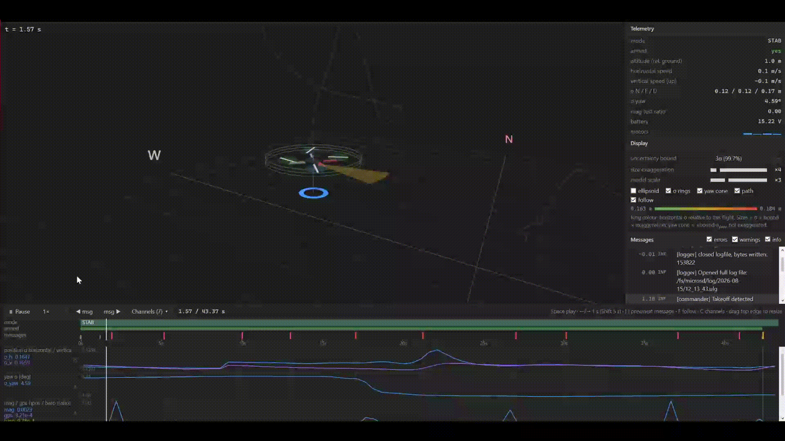

# PX4 Log Analyzer

A handmade tool for analysing flight logs (`.ulg`) from PX4 drones: a 3D replay of the flight with the EKF2 state estimate, its uncertainty, and every estimator flag laid out on a single timeline.



## Why?

While preparing for ERC 2026, our club's Matek H743-based drone kept losing its magnetometer. It would scream `Strong magnetic interference`. We tried a lot of things: moving the compass cables away from the power cables, making them shorter so the I2C bus would be more reliable. In the end we never fully figured it out. Later the horizontal position estimate got really bad, with errors of up to 3 m in flight, which made the missions very hard to complete.

I started this project to learn a bit of backend and frontend, then realised that visualising logs is a much better way to understand what happens to a drone in flight. Nobody remembers "at 30.34 s the drone acted bizarre". You remember a manoeuvre that was out of the ordinary: a fly-away, a weird jerk, a slow drift. This tool lets you scrub to that moment and see what EKF2 was doing: which sensors it trusted, which it rejected, and how sure it was about its own state.

## Features

- **3D replay.** A generic quadcopter flies the logged trajectory with the logged attitude. Rotor layout comes from the `CA_ROTORx_*` parameters, and prop brightness follows the motor outputs.
- **EKF2 uncertainty in 3D.**
  - Position covariance ellipsoid (σN, σE, σD) around the drone.
  - A trail of σ rings along the path, coloured from low to high.
  - A yaw cone showing ±σ of heading.
- **Timeline.** Flight modes, armed state, and all log messages as markers (red errors, orange warnings, grey info), with hover tooltips and click-to-seek.
- **136 EKF2 channels on demand**, picked from a searchable list and stacked as lanes under the timeline:
  - covariance σ of all 24 states, and the state values (biases, earth and body magnetic field, wind, terrain)
  - innovations with ±σ, and innovation test ratios with the rejection threshold drawn in
  - every aiding source (GNSS, baro, mag, gravity, ...): test ratio, fused, rejected
  - all `cs_*` control-status and `fs_*` fault flags, plus estimator events (resets, alignments)
  - measured magnetic field strength and inclination against the WMM model
  - EKF yaw against the EKF-GSF emergency yaw estimator
  - multi-EKF selector, GPS quality, IMU vibration and clipping
- **Primary-instance aware.** With several EKF2 instances running, each sample comes from whichever instance was primary at that moment.
- **REST API + SQLite** for storing flights, parameters and messages (the original goal of the project).

## What it found on our log

The example log in the screenshot was enough to explain the compass problem:

- The magnetometer read **0.31 G** against **0.506 G** expected by the World Magnetic Model, with an inclination of **35°** instead of **68°**. It was already wrong on the ground before take-off, and did not correlate with throttle or current.
- EKF2 flagged the field as disturbed (`cs_mag_field_disturbed`) and **did not fuse the magnetometer at all for the first 20 s**. Heading came from gyro integration only (σ yaw ≈ 4.6°).
- Yaw only became trustworthy (σ ≈ 1.4°) after the first aggressive manoeuvre, when heading became observable from GPS velocity (`cs_mag_aligned_in_flight`).
- The `MAG #0 TIMEOUT` errors are a separate problem. Only 4 of the 10 timeouts were followed by a rejected measurement.

The likely causes are a bad calibration or a static magnet near the compass. EMI from the power wiring is unlikely, since the field didn't correlate with current.

## Quick start

Requires Python 3.10+. On Windows use WSL, it's surprisingly good and efficient nowadays.

```bash
git clone https://github.com/KTokarekPW/px4-log-analyzer.git
cd px4-log-analyzer
python3 -m venv .venv && source .venv/bin/activate
pip install -r requirements.txt
uvicorn app.main:app --reload
```

1. Open http://localhost:8000/docs and upload a `.ulg` with `POST /flights`.
2. Open http://localhost:8000/viewer/1 (use the `id` returned by the upload).

The viewer loads three.js from a CDN, so it needs an internet connection.

### Without the server

```bash
python -m app.viz logs/flight.ulg -o viz.json
```

Open `app/static/viewer.html` in a browser and drop `viz.json` onto it.

### Viewer controls

| key / action | does |
|---|---|
| `Space` | play / pause |
| `←` `→` | ±1 s (`Shift` for ±5 s) |
| `[` `]` | previous / next message |
| `F` | toggle camera follow |
| `C` | open the channel picker |
| click / drag on timeline | seek |
| `✕` next to a lane | remove that channel |
| drag the top edge of the bottom panel | resize |

The channel selection and panel height are remembered in the browser.

## Reading the plots

- **σ (sigma)** is EKF2's own 1-σ uncertainty, from the diagonal of its covariance matrix. It is what the filter *believes*, not a measured error. A filter fed bad data can be confidently wrong.
- **Test ratio** = innovation² / (gate² · innovation variance), where the gate is `EKF2_*_GATE` in σ.
  - `0` means the measurement agrees perfectly with the prediction.
  - `1` means the innovation is exactly at the gate.
  - `> 1` means **the measurement is rejected**.

  To convert to sigmas: `gate · √ratio`. A ratio that stays near zero all flight usually means the sensor noise parameter is set too high. Frequent values above 0.5 mean it is set too low, or the sensor has a problem.
- **A rejected sample is not the same as disabled fusion.** A test ratio above 1 drops that one sample. Whether a sensor is fused at all is shown by the `cs_*` flags (e.g. `cs_mag_3d`, `cs_gnss_pos`).

## API

| method | endpoint | |
|---|---|---|
| `POST` | `/flights` | upload a `.ulg` (201 if new, 200 if the same file was already uploaded) |
| `GET` | `/flights` | list flights |
| `GET` | `/flights/{id}` | flight summary |
| `DELETE` | `/flights/{id}` | delete the flight and its stored file |
| `GET` | `/flights/{id}/params?search=EKF2_` | parameters at log start |
| `GET` | `/flights/{id}/messages?level=error` | log messages |
| `GET` | `/flights/{id}/topics` | logged uORB topics |
| `GET` | `/flights/{id}/topics/{name}?fields=q[0],q[1]` | raw topic data, decimated |
| `GET` | `/flights/{id}/viz` | everything the viewer needs, as JSON |
| `GET` | `/viewer/{id}` | the 3D viewer |

## Project structure

```
app/
├── parser.py        .ulg -> metadata, parameters, messages, topic list
├── db.py            SQLite engine and session
├── models.py        tables: flights, parameters, log_messages, topics
├── schemas.py       Pydantic response models
├── ingest.py        parse + store a log (also a CLI: python -m app.ingest file.ulg)
├── viz.py           build the viewer JSON and the EKF2 channel catalog
├── main.py          FastAPI endpoints
└── static/
    └── viewer.html  three.js viewer (single file, no build step)
```

Time series are **not** stored in the database. They stay in the original `.ulg` and are read on demand, which takes about 30 ms for a 2 MB log. The database only keeps metadata, parameters, messages and the topic list.

## Notes and limitations

- Positions are PX4's local NED frame relative to the EKF origin. The ground level in the viewer is the lowest point of the flight.
- The covariance layout is detected from `n_states`. EKF2 v1.15+ (25 states) gets full support. Older logs (24 states) have no direct attitude σ, so the yaw cone is not shown.
- Uncertainty sizes in 3D are exaggerated by default (3σ × 4), because 10 cm σ would be invisible next to a 30 m trajectory. Use the slider to change it.
- Tested on multicopter logs only. Fixed-wing and VTOL logs will load, but the model is always a quad.
